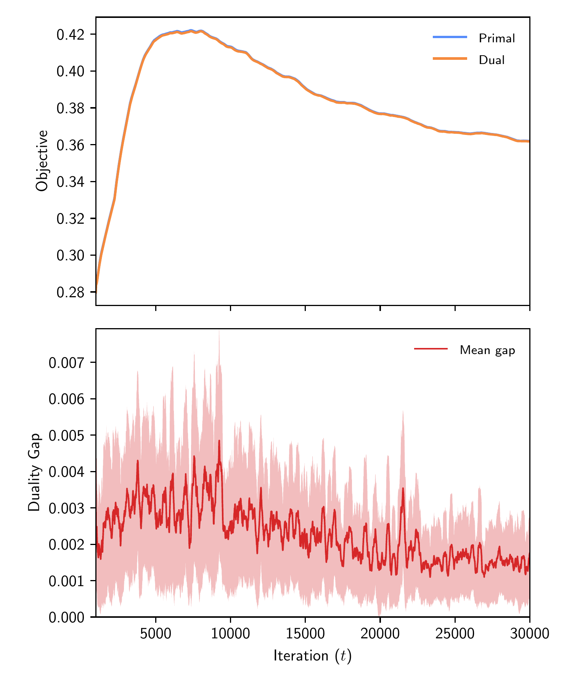
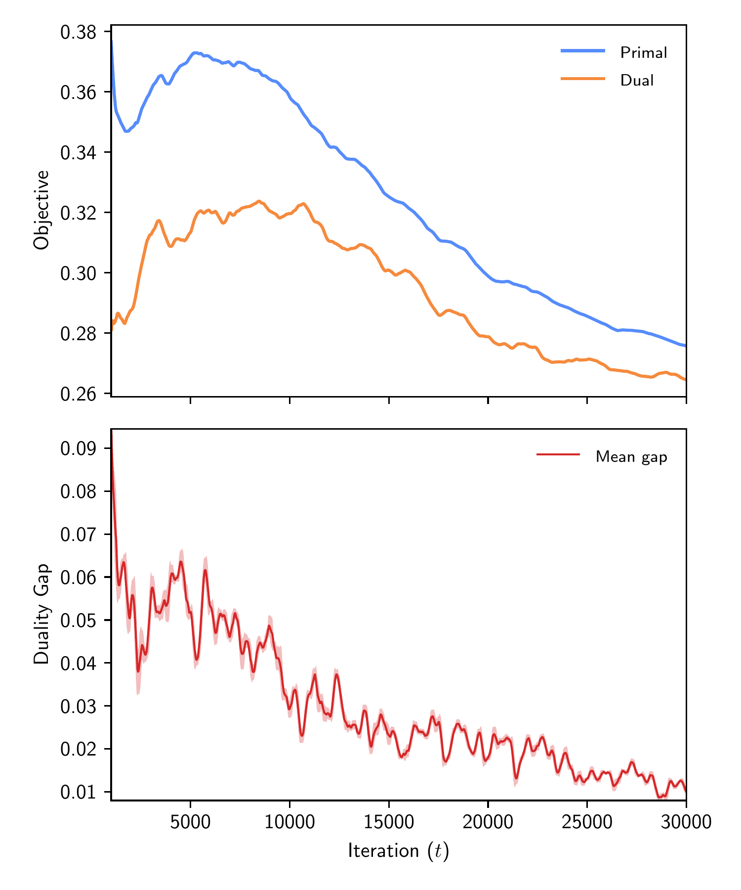
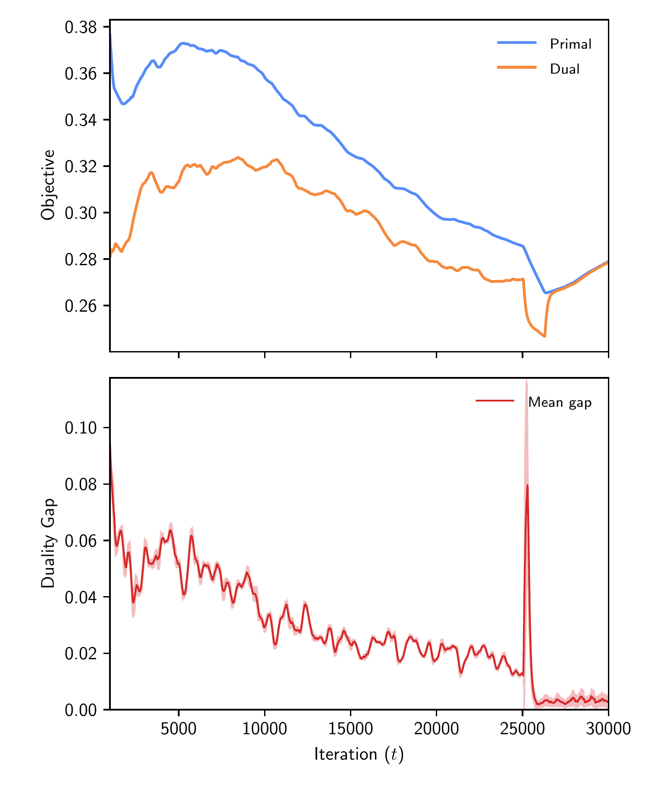
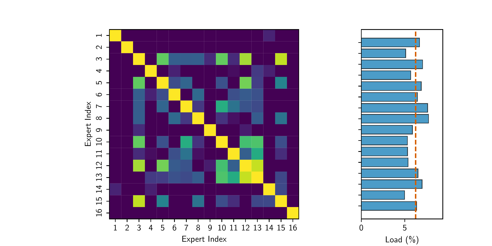
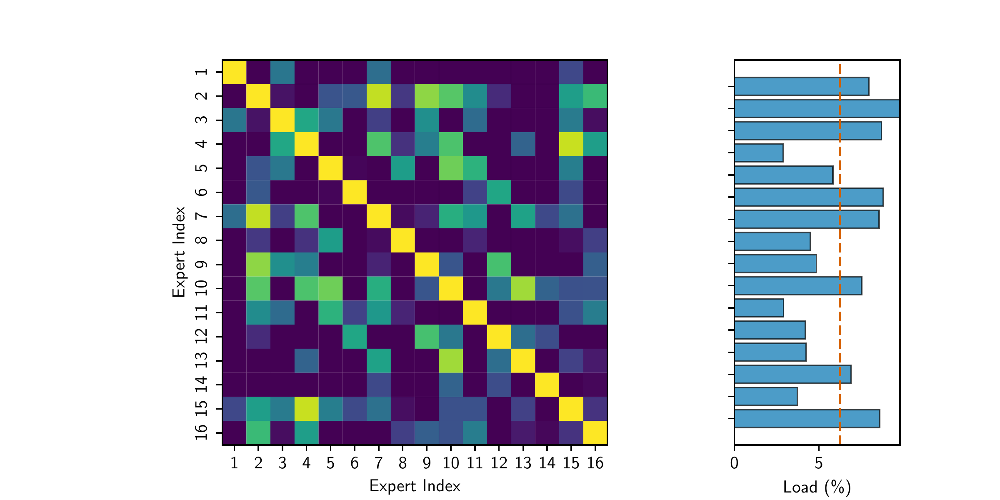
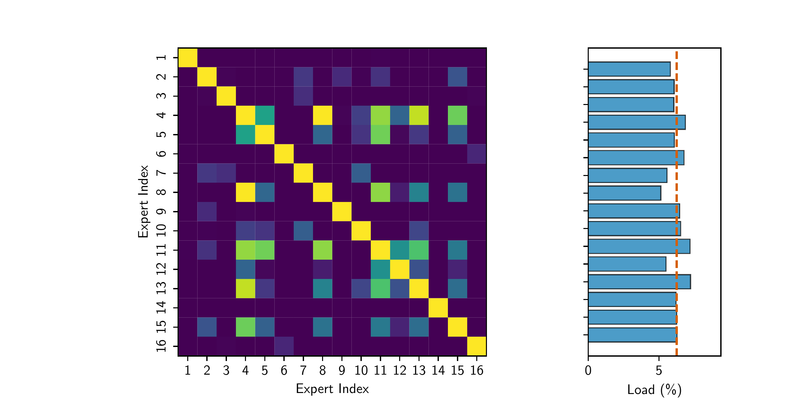

# Stochastic Lagrangian Control and Proportional Bias Routing for Mixture-of-Experts

[](LICENSE)
[](https://doi.org/10.5281/zenodo.23214045)
[](https://www.python.org/)
[](https://pytorch.org/)
[](https://github.com/lambda-z-lab/lz-moe-slc)
[](https://github.com/lambda-z-lab/lz-moe-slc)
[](https://github.com/lambda-z-lab)

> **Official Research Paper Draft & Companion Code**
> 
> **Title:** *Stochastic Lagrangian Control and Proportional Bias Routing for Mixture-of-Experts*  
> **Author:** Carl Johan Rehn (Lambda-Z-Lab)  
> 
> * **[📥 Download Full Pre-print Draft (PDF)](main.pdf)**
> * **[⚡ Jump to Quick Start & Benchmarking](#-quick-start--benchmarking)**

---

## 🎯 Introduction

Modern Mixture-of-Experts (MoE) architectures scale model capacity without proportional compute costs, but they suffer from *expert collapse*, where a small subset of popular experts absorbs most tokens while remaining capacity sits idle. 

Historically, load balancing relies on heuristic auxiliary loss terms with rigid hyperparameters that cause numerical instability and high sensitivity to noise. To overcome these limitations, this paper returns to first-principles constrained optimization and control theory, evaluating two auxiliary-loss-free routing mechanisms:

1. **Stochastic Augmented Lagrangian Control (SLC):** Casts token routing as a formal constrained optimization problem, employing dual shadow prices and an augmented Lagrangian function to enforce strict capacity constraints via robust two-timescale saddle-point updates.
2. **Proportional Bias Routing:** Formalizes the control strategy popularized by DeepSeek-V3, utilizing mean-preserving proportional feedback integrators driven by hard token dispatch counts.

### Key Contributions & Unification
* **Primal-Dual Unification:** We establish an explicit economic correspondence where the negative router bias acts as a heuristic dual price ($v_j \leftrightarrow -b_j$), unifying both architectures under a single convergence framework.
* **Advanced Control Mechanics:** We document robust stabilization components including momentum-filtered dual ascent, $\epsilon$-insensitive dead-band slack filtering, and linear dual learning-rate warmups.
* **Representational Orthogonality:** We prove that SLC prevents expert collapse while expanding the expert centroid singular value spectrum ($S_1/S_{\text{last}}$) from **1.49 to 6.33**, driving experts toward orthogonal functional bases.
* **Scale-Invariant Consumer Hardware Research:** Because the stochastic approximations governing dual prices operate independently of sequence semantics, the stability and representation verified on local consumer hardware (RTX 3060) translate directly to industrial-scale MoE pre-training.

---

## 🧮 Methodology

Following the architectural layout of modern open-weights models like DeepSeek-V3, we formulate the routing problem within a sparsely-gated Mixture-of-Experts layer operating downstream of a Multi-Head Latent Attention (MLA) block.

### Geometry and Token-Expert Affinities
Let $B$ denote the mini-batch size, $T$ the sequence length (yielding a total of $N = B \cdot T$ active tokens), $d_\ell$ the latent feature dimension, and $E_r$ the number of conditionally routed experts. Expert centroids $\mathbf{W} \in \mathbb{R}^{E_r \times d_\ell}$ are projected onto the unit sphere after every update step, ensuring $\|\mathbf{w}_j\|_2 = 1$ for all experts $j \in \{1, \dots, E_r\}$.

Given a latent token representation $\mathbf{x}_i \in \mathbb{R}^{d_\ell}$, the router scores token $i$ against expert $j$ via the scaled affinity:
$$A_{ij} \;=\; \frac{\mathbf{x}_i^\top \mathbf{w}_j}{\sqrt{d_\ell}},$$
which functions as a scaled inner product. Letting $k$ denote the routing sparsity level (i.e., the number of selected experts per token), we define the per-token mean routing utility as the average selected affinity for a binary assignment matrix $P \in \{0, 1\}^{N \times E_r}$ subject to $\sum_{j=1}^{E_r} P_{ij} = k$:
$$U(P, \mathbf{W}) \;=\; \frac{1}{N} \sum_{i=1}^{N} \sum_{j=1}^{E_r} P_{ij} A_{ij}.$$

### Stochastic Augmented Lagrangian Control (SLC)
Now, we formalize the optimization-driven control loop. The Lagrangian router casts load balancing as a constrained utility maximization problem solved via adaptive control. Introducing per-expert dual prices $\mathbf{v} \in \mathbb{R}^{E_r}$ and a quadratic augmentation parameter $\rho > 0$, the empirical mini-batch augmented Lagrangian is expressed in terms of the per-token mean routing utility:
$$\mathcal{L}(P, \mathbf{W}, \mathbf{v}) \;=\; U(P, \mathbf{W}) \;-\; \mathbf{v}^\top \hat{\mathbf{e}}_t \;-\; \frac{\rho}{2} \|\hat{\mathbf{e}}_t\|_2^2,$$
where $\hat{\mathbf{e}}_t$ is the shared recursive load-error estimator defined in the paper.

#### Duality-Adjusted Routing Affinity
To stabilize the routing dynamics, the optimization framework computes a closed-loop control signal—the duality-adjusted routing affinity, which is fed directly into the active top-$k$ selection and softmax gating mechanism:
$$\Psi_{ij}^{\text{SLC}} \;=\; A_{ij} - v_j - \rho \, \hat{e}_{t,j}.$$
Here, $\Psi_{ij}^{\text{SLC}}$ acts as the primary control input: the dual variables $v_j$ provide integral feedback via recursive dual-price estimation, while the recursive load errors $\hat{e}_{t,j}$ provide proportional feedback scaled by the augmented penalty parameter $\rho$.

#### Top-$k$ Selection and Unbiased Gating
To map the duality-adjusted affinities into discrete execution paths, hard top-$k$ selection operates on the closed-loop control signal, whereas gating utilizes the *unbiased* token-expert affinities $A_{ij}$ for the selected subset. This design cleanly decouples routing decisions (&ldquo;where to send&rdquo;) from feature weighting (&ldquo;how much to weight&rdquo;):

$$\begin{aligned}
\mathcal{K}_i &= \operatorname{Top-k}_{j}\!\left( \Psi_{ij}^{\text{SLC}} \right), \qquad |\mathcal{K}_i| = k, \\
G_{ij} &= \operatorname{softmax}_{j\in\mathcal{K}_i}\!\big( A_{ij} \big),
\end{aligned}$$

where $G_{ij}$ denotes the gating weight for token $i$ assigned to expert $j \in \mathcal{K}_i$.

These discrete expert indices $\mathcal{K}_i$ and continuous gating weights $G_{ij}$ serve as the structural dispatch interface of the router, mapping abstract control signals and input tokens to their designated expert networks.

---

## 📊 Key Empirical Results & Visualizations

### Experimental Setup Overview

To evaluate the comparative dynamics of Stochastic Augmented Lagrangian Control (SLC) against the DeepSeek proportional bias baseline, we implement a 6-layer decoder-only Mixture-of-Experts transformer model integrated with Multi-Head Latent Attention. Our primary analysis focuses on the terminal, highest-congestion layer (Layer 6). Models are trained for $30,000$ iterations on the TinyStories corpus using a mini-batch size of $B = 16$ and a context window of $T = 256$ tokens. All experiments are executed in mixed precision on consumer-grade hardware (NVIDIA RTX 3060) using the TinyStories corpus ($30,000$ steps).

### Stress Testing via Regime Switching

To rigorously evaluate the dynamic responsiveness and transient recovery of our optimization framework, we subject the Mixture-of-Experts routing layer to a regime-switching stress test. In this configuration, the transformer is trained for the first $25,000$ iterations using the heuristic DeepSeek proportional bias baseline. At iteration $25,000$, the active routing controller is abruptly hot-swapped to Stochastic Augmented Lagrangian Control (SLC) without resetting model weights, expert centroids, or optimizer states. This setup tests a severe edge case: whether a formal Augmented Lagrangian controller can dynamically adapt to a suboptimal, heavily pre-conditioned state mid-training, resolve constraint violations and load imbalances, and actively steer the system toward an optimal saddle-point equilibrium, rather than relying on a clean initialization.

### Quantitative Performance and Generalization

Below, the table summarizes the primary performance metrics comparing the auxiliary-loss-free DeepSeek baseline against our proposed SLC architecture at step 30,000 (Layer 6). As detailed, SLC achieves a lower window-mean validation loss ($1.6991$ vs $1.7040$ over the final 5k steps), while reducing maximum load violation by nearly two orders of magnitude ($0.0057$ versus $0.5410$), proving that the dual prices effectively prevent expert collapse. While SLC incurs a minor computational overhead ($\approx 1.1\%$ throughput reduction, dropping from $272.18$ to $269.23$ iterations/minute) due to the evaluation of the recursive load-error estimator and dual updates, this &ldquo;control tax&rdquo; is negligible.

| Routing Architecture | Val Loss ($\downarrow$) | Max Load Violation ($\downarrow$) | Duality Gap ($\downarrow$) | Throughput (it/min $\uparrow$) |
| :--- | :---: | :---: | :---: | :---: |
| DeepSeek Baseline | 1.7040 | 0.5410 | N/A | **272.18** |
| **SLC MoE (Ours)** | **1.6991** | **0.0057** | **0.085%** | 269.23 |

To ensure that soft expected assignment probabilities accurately reflect hard token dispatch counts, routing calibration is evaluated using both the Mean Absolute Error ($\text{MAE}$) and the Kullback-Leibler ($\text{KL}$) divergence between soft routing probabilities and normalized hard token histograms. Calibration verification confirms that both models maintain tight correspondence (staying well below a $2\%$ error threshold) validating the reliability of the routing probabilities. Specifically, Stochastic Augmented Lagrangian Control achieves superior calibration with an $\text{MAE}$ of $1.15\%$ ($\text{KL} = 0.00166$) compared to the DeepSeek baseline's $\text{MAE}$ of $1.71\%$ ($\text{KL} = 0.00327$). This shows that SLC's dual-controlled feedback loop achieves a superior distribution than the fixed update gain of proportional bias routing.

### Primal-Dual Convergence Dynamics and Duality Gaps
A primary advantage of formulating Mixture-of-Experts load balancing through an augmented Lagrangian framework is the availability of an explicit optimization-theoretic convergence metric (the duality gap). To evaluate the primal-dual dynamics, the following plots show the trajectories of the primal utility, dual values, and duality gap across three regimes, focusing on the terminal layer (Layer 6).

<div align="center" style="display: flex; justify-content: center; align-items: flex-start; gap: 20px; flex-wrap: wrap;">
  <div style="flex: 1; min-width: 250px; text-align: center;">
    
    <br><b>SLC</b>
  </div>
  <div style="flex: 1; min-width: 250px; text-align: center;">
    
    <br><b>DeepSeek Bias</b>
  </div>
  <div style="flex: 1; min-width: 250px; text-align: center;">
    
    <br><b>Regime-Switch</b>
  </div>
</div>

As illustrated, the SLC router achieves a stable saddle-point equilibrium by step $20,000$, with the duality gap dropping below $0.085\%$. The dual objective values smoothly reflect the satisfaction of the load constraints without high-frequency chattering, illustrating the efficiency of the momentum filter and $\epsilon$-insensitive dead-band. In contrast, the DeepSeek baseline with a proportional bias displays a wider divergence band and settles at a higher final duality gap of $3.64\%$, reflecting the high penalties required to enforce expert load distributions and the absence of the augmented Lagrangian's local convexity. Most notably, the regime-switch experiment captures the adaptive elasticity of SLC: when SLC is abruptly activated at step $25,000$ following training under DeepSeek's sluggish baseline, the dual variables immediately re-orient and absorb the transient shock, reducing the duality gap to $0.28\%$ by step $30,000$.

### Expert Geometry, Diversity, and Micro-Clustering
To evaluate the impact of dual routing control on internal representations, we perform a spectral analysis of the expert centroid matrix $\mathbf{W}$. The following table summarizes the geometric control diagnostics across all three evaluated regimes at iteration $30,000$. As shown in the table, SLC prevents the representational collapse common in heuristic routers. The spectral ratio of the centroid singular values ($S_1/S_{\text{last}}$) increases from $1.49$ in the baseline to $6.33$ under SLC, indicating a well-conditioned singular value spectrum that avoids dimensional dominance. Furthermore, the mean pairwise cosine similarity among expert centroids drops to $-0.037$ under SLC and $-0.039$ under the regime-switch experiment, indicating that expert representations have evolved into near-orthogonal basis vectors (compared to DeepSeek's diffuse similarity of $+0.007$).

| Metric | DeepSeek | SLC (Ours) | Regime-Switch |
| :--- | :---: | :---: | :---: |
| Spectral Ratio ($S_1 / S_{\text{last}}$) | 1.49 | **6.33** | 3.11 |
| Mean Cosine Sim ($\text{avg\_sim}$) | $+0.0073$ | **$-0.0370$** | $-0.0390$ |
| Load Std Dev ($\text{std}\%$) | 2.36\% | **0.89\%** | 0.59\% |

To visualize these structural differences, the plots in the master diagnostic stack detail the cross-expert cosine similarity heatmaps alongside the corresponding load error distributions. While the DeepSeek baseline exhibits a diffuse, uncoordinated similarity profile and large variations in load distribution, SLC and the regime-switch experiment display structured micro-clusters of functional specialization paired with evenly distributed expert loads. The Lagrangian dual prices compel the 16 experts to operate as an orthogonalized, multi-faceted basis set rather than collapsing into redundant, overlapping feature extractors.

<div align="center">
  <figure>
    
    <figcaption style="text-align: center; max-width: 65%; margin: 5px auto 25px auto;"><b>SLC:</b> Exhibiting clear micro-clustering (experts 10–13).</figcaption>
  </figure>

  <figure>
    
    <figcaption style="text-align: center; max-width: 65%; margin: 5px auto 25px auto;"><b>DeepSeek Bias:</b> Displaying diffuse micro-clustering.</figcaption>
  </figure>

  <figure>
    
    <figcaption style="text-align: center; max-width: 65%; margin: 5px auto 25px auto;"><b>Regime-Switch:</b> Exhibiting micro-clustering (experts 11–13).</figcaption>
  </figure>
</div>

---

## 💻 Installation & Environment Setup

1. **Clone the repository and set up a virtual environment:**
   ```bash
   python -m venv --system-site-packages .venv
   source .venv/bin/activate
   pip install --upgrade pip
   ```

2. **Install the package and CPU-only PyTorch:**
   ```bash
   pip install -e . --extra-index-url https://download.pytorch.org/whl/cpu --no-cache-dir
   ```

---

## 🚀 Quick Start & Benchmarking

You can verify the routing mechanisms and test stochastic load-skew recovery directly through interactive Python (`IPython`):

```bash
python -m IPython
```

```python
In [1]: import torch
In [2]: from benchmarks.benchmark_routers import run_benchmark
In [3]: torch.manual_seed(42)
   ...: run_benchmark("SLC", steps=150)
   ...: run_benchmark("DeepSeekBias", steps=150)
```

### Expected Benchmark Output
```text
--- Benchmarking Router Variant: SLC ---
Step [50/150]  | Primal: 0.3029 | Dual: 0.3036 | Gap: 0.0007
Step [100/150] | Primal: 0.3026 | Dual: 0.3025 | Gap: 0.0001
Step [150/150] | Primal: 0.3023 | Dual: 0.3024 | Gap: 0.0000
Completed 150 steps in 0.3387 seconds.

--- Benchmarking Router Variant: DeepSeekBias ---
Step [50/150]  | Primal: 0.3399 | Dual: 0.3274 | Gap: 0.0124
Step [100/150] | Primal: 0.3392 | Dual: 0.3374 | Gap: 0.0018
Step [150/150] | Primal: 0.3386 | Dual: 0.3395 | Gap: 0.0010
Completed 150 steps in 0.3406 seconds.
```

---

## 🧪 Running Unit Tests

To validate tensor shapes, unit-sphere centroid tracking, and calibration diagnostics:
```bash
pytest tests/test_routers.py
```

---

## 📖 Citation

If you build upon this research, utilize the theoretical framework, or reference this code base, please cite it using the following BibTeX entry:

```bibtex
@software{rehn2026lzmoeslc,
  author = {Rehn, Carl Johan},
  title = {Stochastic Lagrangian Control and Proportional Bias Routing for Mixture-of-Experts: Companion Code},
  year = {2026},
  publisher = {Zenodo},
  doi = {10.5281/zenodo.23214045},
  url = {https://github.com/lambda-z-lab/lz-moe-slc}
}
```

---

## 🛡️ License

This project is open-source under the terms of the [MIT License](LICENSE).

