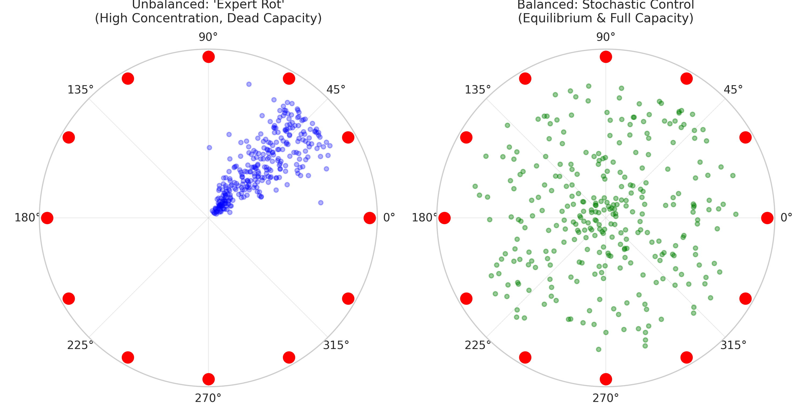

# Cracking the MoE Routing Problem: Why Stochastic Control Beats Heuristic Fixes

*By Carl Johan Rehn*

Mixture-of-Experts (MoE) architectures have quietly become the backbone of modern large language models, allowing models to scale to hundreds of billions of parameters without paying a proportional penalty in compute. The core mechanism enabling this magic is the **router**—a traffic cop living inside the transformer layers that inspects incoming tokens and routes them to a small, specialized subset of "experts" (feed-forward sub-networks). 

In theory, this creates a divide-and-conquer paradise where different experts specialize in syntax, factual knowledge, or coding logic. In practice, standard MoE training regimes frequently suffer from a pathological failure mode we call **Expert Rot**. Because of a self-reinforcing feedback loop—the Matthew effect (*"the rich get richer"*)—a small handful of popular experts capture the vast majority of token dispatches early on. The rest of the model’s capacity sits idle, functioning as expensive, dormant dead weight.

To fix this, the deep learning community has leaned heavily on heuristic fixes, such as DeepSeek-style proportional bias adjustments. While these patches attempt to force balance, they frequently destabilize the primary loss manifold. 

To build resilient, industrial-scale sparse models—even when training on modest, consumer-grade hardware like a single RTX 3060—we need to return to first-principles constrained optimization. By viewing MoE routing through the lens of **stochastic control theory**, we can replace brittle heuristics with a self-regulating economic market that guarantees long-term distributional equilibrium.

---

### 1. What is MoE Routing? Geometry and Token-Expert Affinities

To understand how a router makes decisions, imagine a high-dimensional semantic space where every incoming token is represented as a point (a vector), and every expert is represented by its own fixed point in that same space, known as an **expert centroid**. 

Think of these expert centroids as permanent anchor points planted on the surface of a multi-dimensional sphere. Every time a token passes through the layer, the router calculates how closely aligned that token's semantic meaning is with each available expert. 

We measure this alignment using a **scaled affinity score**. If a token representing a snippet of Python code arrives, its vector will point closely toward the centroid of an expert that has implicitly specialized in programming, yielding a high affinity score. Conversely, its affinity with an expert specializing in French poetry will be near zero or negative.

The router's job is to evaluate these inner-product affinities across all available experts and select a fixed, sparse number of winners for each token. If a model uses a routing sparsity level of two, the router connects each token to its top two most compatible experts, discarding the rest for that specific layer pass.

#### Visualizing the Routing Space
Imagine a circular radar screen. The center represents the neutral origin, and the perimeter is studded with expert centroids pointing in different directions. Incoming tokens flash onto the screen like blips. 
* **Unbalanced Routing (Expert Rot):** All the incoming token blips magnetically pull toward just two or three popular expert centroids, leaving the rest of the radar perimeter completely dark and inactive.
* **Balanced Routing:** The token blips distribute fluidly across all directions, ensuring that every expert centroid on the perimeter receives a steady, equitable share of incoming traffic over time.

  

    
  

---

### 2. Defining Routing Utility: Maximizing Semantic Match

If routing is just matching tokens to experts, how do we evaluate whether a routing decision is "good"? We measure it through **routing utility**.

Routing utility represents the aggregate quality of the matches made across a batch of text. It is calculated by taking the sum of the affinity scores for every successful token-expert pairing, averaged across the entire batch. A high routing utility means the model is successfully pairing tokens with the experts that understand them best; a low utility means tokens are being forced into suboptimal, mismatched experts.

If left completely unconstrained, the model will aggressively chase maximum short-term routing utility. It will route as many tokens as possible to the top three "master-of-all-trades" experts because they provide a safe, high-affinity match early in training. This greedy optimization is precisely what causes Expert Rot. The system sacrifices long-term model capacity for short-term convenience.

To prevent this, we must treat MoE routing not as a free-for-all popularity contest, but as a **constrained resource allocation program**. We want to maximize total routing utility *subject to a strict operational constraint*: over the long run, every expert must handle its fair share of the workload.

---

### 3. The Trap of Mini-Batches: Why Hard Constraints Fail

When engineers first try to enforce balanced workloads, they usually implement a hard constraint at the mini-batch level. They declare: *"Every mini-batch of 16 text sequences must distribute its tokens perfectly and equally across all 16 experts."*

This sounds logical, but in practice, it poisons training stability. 

Natural language is inherently stochastic and bursty. A single mini-batch might consist entirely of dense mathematical equations, while the very next mini-batch is casual dialogue. If you force a rigid, hard quota on every single isolated mini-batch, you introduce massive, high-frequency combinatorial noise. The model spends all its gradient updates violently thrashing its routing weights trying to satisfy an artificial quota for text it hasn't even seen yet, destroying the primary language-modeling loss manifold.

#### The Infinite-Horizon Solution
The secret to stable scaling—whether on a massive industrial cluster or a local RTX 3060 workstation—is shifting our perspective. **Stochastic optimization does not care about micro-managing individual mini-batches.** 

Instead, it targets **distributional equilibrium over an infinite horizon**. Just as a central bank doesn't panic over daily currency fluctuations but manages economic stability over quarters and years, a robust MoE router relaxes mini-batch constraints. It accepts that individual mini-batches will be noisy and unbalanced, provided that the *expected* load converges to the target capacity over the broader course of training.

---

### 4. Engineering the Fix: Soft Expected Counts and Noise Filtering

To operationalize this stochastic approach without breaking standard deep learning training loops, we need a computational pipeline that can track loads and filter out high-frequency sampling noise. This is achieved through three integrated mechanisms:

1. **Soft Expected Counts (The Differentiable Proxy):** Instead of making hard, discrete routing choices that break backpropagation, the router computes smooth, probabilistic routing distributions for every token across all experts. By summing these probabilities across the mini-batch, the system derives a continuous, differentiable estimate of expected expert loads. This gives our control system a smooth mathematical surface to push against.
2. **Stochastic Load-Error Estimation (The Low-Pass Filter):** Because raw mini-batch counts bounce around wildly based on the text in the current window, we pass the raw load violations through a recursive Exponential Moving Average (EMA) filter. Operating identically to a low-pass filter in electronic signal processing, this estimator strips out the high-frequency sampling noise of mini-batch token delivery while isolating the slowly varying structural capacity imbalances that cause Expert Rot.
3. **The Control Loop in the Training Loop:** With clean, smoothed load error signals in hand, dynamic pricing variables (dual variables or shadow prices) act as a tax-and-subsidy mechanism. If an expert starts capturing too much traffic over time, the system applies a mild routing "tax" to its affinity scores, making it slightly less attractive. If an expert is starved, it receives a "subsidy." 

---

### Moving Forward

By shifting our view of MoE routing from heuristic patching to classical resource allocation under uncertainty, we completely change the game. We stop fighting our models with brittle, high-frequency constraints and instead use recursive estimation and stochastic control to guide them toward natural equilibrium.

Best of all, because these stochastic approximations and noise-filtering mechanisms operate independently of vocabulary size or sequence semantics, the stability you verify on a local consumer workstation translates directly and predictably to industrial-scale pre-training. Mathematics, it turns out, scales down just as well as it scales up.

---

### Open Science & Reproducibility
To explore the mathematical derivations, complete proof structures, and open-source implementations behind Lagrangian routing, all project materials are publicly accessible:

**Formal Research & Technical Notes:**
* **[Core Technical Report (PDF):](https://github.com/lambda-z-lab/lz-moe-slc/blob/main/main.pdf?raw=true)** *Stochastic Lagrangian Control and Proportional Bias Routing for Mixture-of-Experts.* ([Zenodo Record](https://doi.org/10.5281/zenodo.24283170))
* **[Technical Note (PDF):](https://github.com/lambda-z-lab/lz-moe-slc/blob/main/doc/tech_note_foundations_1.pdf?raw=true)** *Foundations of Sparse Mixture-of-Experts Routing Part — I* ([Zenodo Record](https://doi.org/10.5281/zenodo.24284691))

**Code & Archives:**
* **[GitHub Repository:](https://github.com/lambda-z-lab/lz-moe-slc)** Complete PyTorch implementation of the Lagrangian Router, control components, and benchmarking scripts.
* **[Zenodo Software Concept DOI:](https://doi.org/10.5281/zenodo.23214045)** Version-controlled snapshots and software archives.
* **[ORCID Record:](https://orcid.org/0009-0002-7844-0770)** Verified independent researcher profile (`0009-0002-7844-0770`).

**Series: Demystifying Mixture-of-Experts Routing**
1. *[Avoiding Expert Collapse in Mixture-of-Experts with Stochastic Control](https://medium.com/@care02/avoiding-expert-collapse-in-mixture-of-experts-with-stochastic-control-59e2b3ba4a3e)*
2. *[Demystifying Top-k Routing: Why Hard Selection Is Not Just a Heuristic](https://medium.com/@care02/demystifying-top-k-routing-why-hard-selection-is-not-just-a-heuristic-ae9075380b8c)*
3. *[Cracking the MoE Routing Problem: Why Stochastic Control Beats Heuristic Fixes](https://medium.com/@care02/cracking-the-moe-routing-problem-why-stochastic-control-beats-heuristic-fixes-97f81ab919d2)*
4. *[Beyond Heuristics: How Stochastic Augmented Lagrangian Control Benefits Expert Selection in MoE](https://medium.com/@care02/beyond-heuristics-how-stochastic-augmented-lagrangian-control-benefits-expert-selection-in-moe-ec4496cdb8a8)*
5. *[Part 5 — Forthcoming]*
