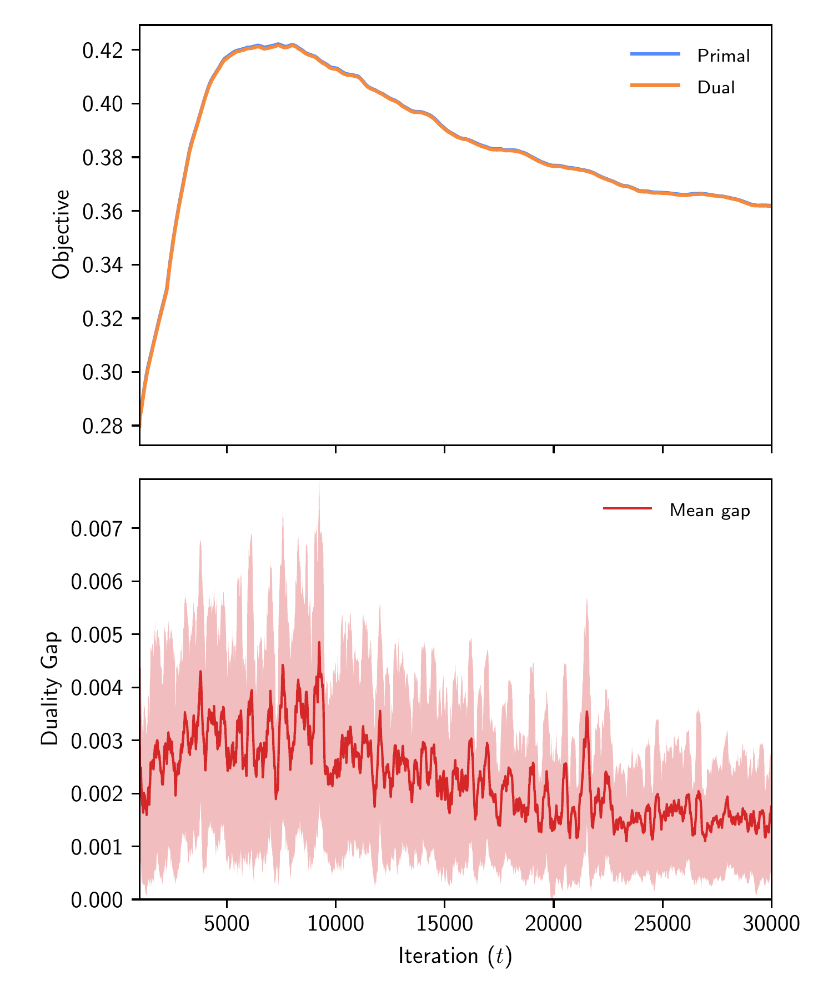
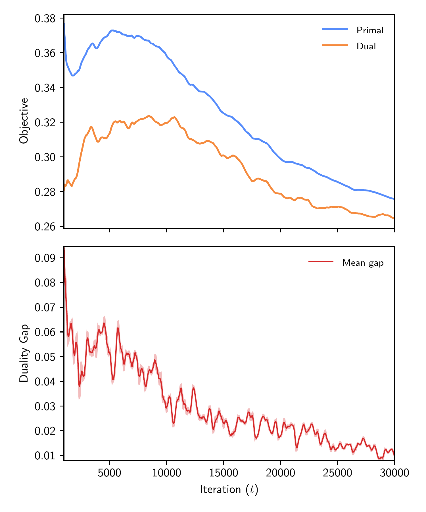
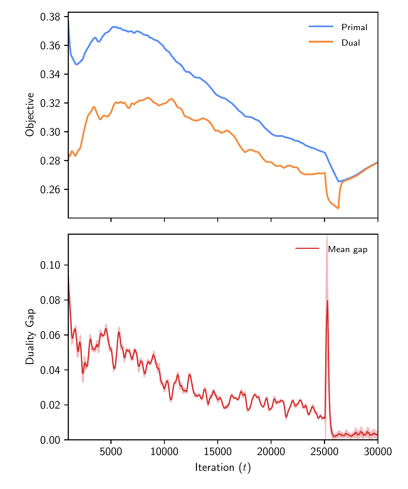
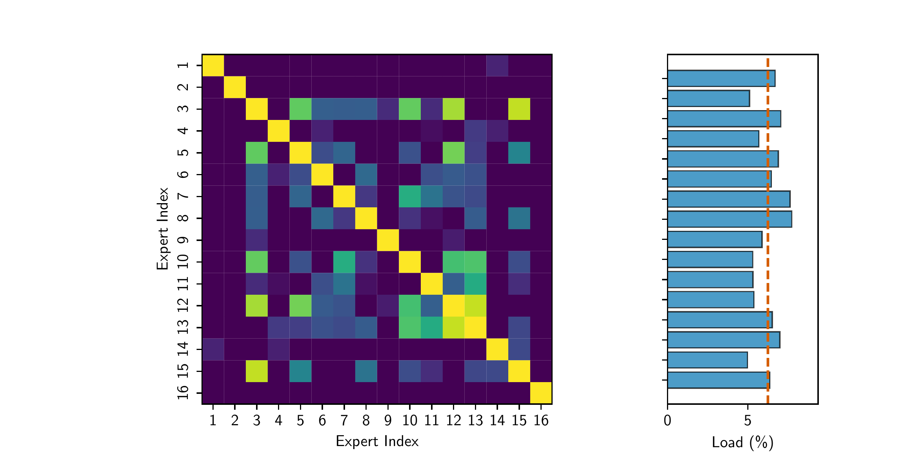
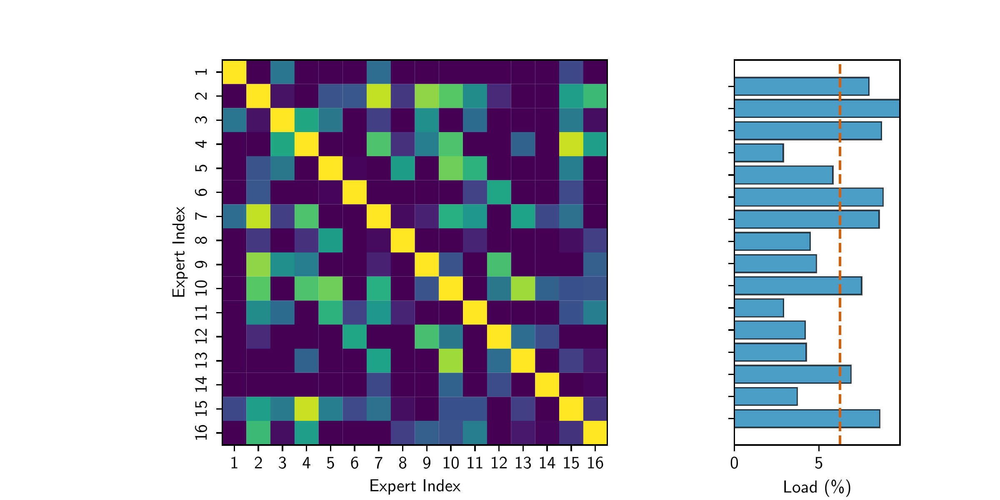
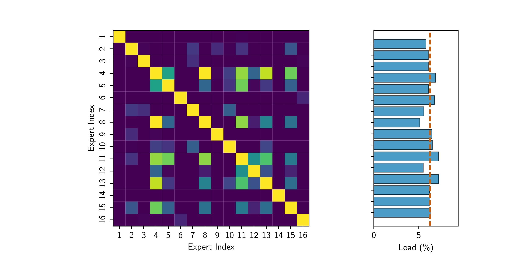

## Avoiding Expert Collapse in Mixture-of-Experts with Stochastic Control

*By Carl Johan Rehn*

In long-running training regimes, standard auxiliary-loss-based MoEs frequently suffer from what can be termed “Expert Rot”—a pathological manifestation of the Matthew effect (“the rich get richer”)—where a small subset of popular experts captures the majority of token dispatches early, leaving the remainder of the model as dormant dead weight. To overcome these structural limitations, we advocate a return to first-principles constrained optimization and control theory. 

### Why Heuristic Fixes Fall Short
DeepSeek-style routing attempts to fix imbalance through proportional bias adjustment, but this frequently destabilizes the primary loss manifold. 

In contrast, the **Stochastic Augmented Lagrangian Control (SLC)** router acts as a dynamic regulator. SLC casts token routing as a formal constrained optimization problem, employing dual variables (shadow prices) and an augmented Lagrangian function to enforce strict expert capacity constraints. By dynamically balancing a tax-and-subsidy pricing mechanism across the expert manifold, SLC forces the model to utilize all available capacity. 

Best of all, because the stochastic approximations governing dual prices are independent of vocabulary size and sequence semantics, the stability verified on local consumer hardware (like an RTX 3060) translates directly to industrial-scale MoE pre-training.

---

### Putting It to the Test: Results & Empirical Evaluation
To validate the theoretical stability, convergence properties, and structural specialization of SLC, we ran a comprehensive evaluation against the DeepSeek proportional bias routing baseline. 

Rather than relying on massive industrial clusters, we trained our models entirely from scratch on a single consumer-grade workstation using the TinyStories corpus (30,000 iterations, mini-batch size B = 16, context window T = 256). Our analysis focuses specifically on the terminal, highest-congestion layer (Layer 6) of a 6-layer decoder-only transformer integrated with Multi-Head Latent Attention (MLA).

To push the system to its limits, we also designed a **regime-switching stress test**: 
* We trained the model for the first 25,000 iterations using the standard DeepSeek baseline. 
* At step 25,000, we abruptly hot-swapped the router to **SLC** without resetting model weights, centroids, or optimizer states. 
* This tested whether an Augmented Lagrangian controller could dynamically rescue a heavily pre-conditioned, suboptimal state mid-flight.

Our evaluation proceeds along two core dimensions: (i) primal-dual convergence dynamics and stability and (ii) latent space geometry and expert micro-specialization.

### 1. Primal-Digital Convergence and Duality Gaps
A primary advantage of formulating load balancing through an augmented Lagrangian is having an explicit optimization-theoretic convergence metric: **the duality gap**. To ensure clear visibility against high-frequency stochastic training noise, the trajectories of primal utility, dual objective value, and duality gap are smoothed via a rolling window-mean of 250 steps.

<table align="center" width="100%" style="border: none;">
  <thead>
    <tr>
      <th align="center" width="33%"></th>
      <th align="center" width="33%"></th>
      <th align="center" width="33%"></th>
    </tr>
  </thead>
  <tbody>
    <tr>
      <td align="center" style="border: none;">
         
        <b>SLC</b>
      </td>
      <td align="center" style="border: none;">
         
        <b>DeepSeek Bias</b>
      </td>
      <td align="center" style="border: none;">
         
        <b>Regime-Switch</b>
      </td>
    </tr>
  </tbody>
</table>

* **SLC:** Achieves a stable saddle-point equilibrium by step 20,000, driving the duality gap down below 0.085%. The dual objectives update smoothly without high-frequency chattering, thanks to a momentum filter and dead-band slack filtering.
* **DeepSeek Baseline:** Displays a wider divergence band, settling at a higher final duality gap of 3.64%.
* **The Regime-Switch Test:** When SLC was hot-swapped at step 25,000, the dual variables immediately absorbed the transient shock, pulling the duality gap down to 0.28% by step 30,000.

Quantitatively, SLC achieved a lower window-mean validation loss (1.6991 vs 1.7040) while reducing maximum load violation by nearly two orders of magnitude (0.0057 vs 0.5410). This came with a negligible computational overhead ("control tax")—a minor \approx 1.1% throughput reduction (269.23 vs 272.18 it/min) due to the dual updates.

### 2. Expert Geometry, Diversity, and Micro-Clustering
Beyond token counts, what happens to the internal representation of the experts? 

Standard heuristic routers often suffer from representational collapse. However, our spectral analysis of the expert centroid matrix revealed striking structural differences:
* **Spectral Ratio (S_1 / S_{\text{last}}):** Expanded from 1.49 in the baseline to **6.33 under SLC**, avoiding dimensional dominance.
* **Orthogonality:** The mean pairwise cosine similarity among expert centroids dropped to **-0.037 under SLC** (and -0.039 in the regime-switch test), pushing expert representations toward near-orthogonal basis vectors compared to the baseline's +0.007.
* **Load Std Dev:** DeepSeek baseline showed 2.36%, dropping to **0.89% under SLC**, and 0.59% in the regime-switch test.

Rather than collapsing into redundant, overlapping feature extractors, Lagrangian dual pricing compels the 16 experts to operate as a structured, multi-faceted, orthogonalized basis set.

To visualize these structural differences, the diagnostic stacks below map the cross-expert cosine similarity heatmaps alongside the corresponding load error distributions. While the DeepSeek baseline exhibits a diffuse, uncoordinated similarity profile and large variations in load distribution, SLC and the regime-switch experiment display structured micro-clusters of functional specialization paired with evenly distributed expert loads. 

  

    
    
<b>SLC:</b> Exhibiting clear micro-clustering (experts 10–13).

    
    
<b>DeepSeek Bias:</b> Displaying diffuse micro-clustering.

    
    
<b>Regime-Switch:</b> Exhibiting micro-clustering (experts 11–13).

  

Our spectral analysis reveals that SLC achieves more than just uniform token counts; it balances the informational quality of the experts. By forcing the centroid singular values to an optimal spectral spread and pushing pairwise cosine similarities near orthogonality, SLC ensures that the router treats the expert pool as true independent basis vectors for the latent data distribution. The model is not merely routing tokens—it is discovering a structured, orthogonal functional basis.

### Scalability to Massive Sparse Architectures
As transformer scaling pushes beyond hundreds of conditional experts (e.g., Mixtral, DeepSeek, and beyond), manual hyperparameter tuning for static auxiliary losses becomes an intractable trial-and-error bottleneck (*"loss-weight hunting"*). 

SLC’s self-correcting dual variables provide a self-regulating, "set-and-forget" stability mechanism, offering a mathematically certified foundation for the next generation of massive-scale sparse models without the need for manual weight tuning.

### Open Science & Reproducibility
To ensure full transparency, all code, execution scripts, and working mathematical notes are publicly accessible:
* **[Technical Report (PDF):](https://github.com/lambda-z-lab/lz-moe-slc/blob/main/main.pdf?raw=true)** Stochastic Lagrangian Control and Proportional Bias Routing for Mixture-of-Experts.
* **[GitHub Repository](https://github.com/lambda-z-lab/lz-moe-slc):** Complete PyTorch implementation of the Lagrangian Router and benchmarking suite.
* **[Zenodo Archive & DOI](https://doi.org/10.5281/zenodo.23214045):** A frozen, version-controlled snapshot of the experimental codebase.

### Conclusions
This work bridges classical optimization theory and modern auxiliary-loss-free Mixture-of-Experts routing. By formulating expert load balancing as a constrained utility-maximization problem, Stochastic Augmented Lagrangian Control provides rigorous saddle-point stability and dynamic control. 

By showing that these advanced control-theoretic mechanisms operate efficiently on standard consumer hardware, we demonstrate that rigorous mathematical foundations for LLMs can be researched, tested, and reproduced outside of massive industrial cluster environments.
