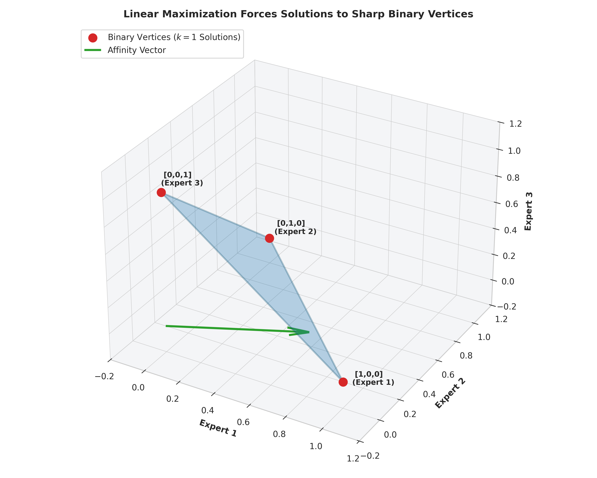

# Demystifying Top-k Routing: Why Hard Selection Is Not Just a Heuristic

*By Carl Johan Rehn*

In the design of modern Mixture-of-Experts (MoE) transformer architectures, a quiet consensus has settled over the community: discrete, hard Top-k selection is treated as a necessary evil. 

Because standard deep learning relies on continuous gradients, discrete operations—such as picking the top-scoring experts out of a pool of dozens—are widely viewed as non-differentiable bottlenecks. Because gradients cannot flow through discrete indices, engineers often treat hard routing as an unprincipled heuristic, relying on continuous relaxations or heavy auxiliary losses to force stability.

This view is built on a misconception.

Hard Top-k selection is not an ad-hoc approximation or a clumsy engineering hack. When examined through the lens of convex optimization and network flow theory, the discrete Top-k operator over router affinities is the exact, closed-form solution to a linear program. It incurs a zero integrality gap, meaning the sharp, binary choice of *where* to send a token is mathematically identical to solving an exact resource-allocation problem.

Let’s unpack how routing actually works under the hood, why hard selection behaves the way it does, and how seeing it as an optimization problem changes our perspective on model stability.

---

### The Structural Interface of the Router: Where to Send, How Much to Weight

To understand the role of Top-k, we first need to look at how a modern sparse router actually interfaces with a transformer layer. 

When a token enters an MoE layer, the router’s job is twofold: it must decide *which* expert networks should process the token, and it must determine *how much weight* to assign to each chosen expert's output. 

This is handled by cleanly decoupling the routing decisions from feature weighting:
1. **The Dispatch Interface (Top-k):** The router computes an affinity score for every available expert (incorporating control signals like load-balancing shadow prices or bias terms). Hard Top-k selection acts as a strict gatekeeper, filtering out the noise and returning a set of discrete expert indices. This acts as the structural dispatch interface—directing the token down precise execution paths.
2. **The Unbiased Gating Mechanism:** Once the specific expert subset is locked in, continuous gating weights are calculated using the raw, unadjusted affinities *only* for the selected subset. 

In short, the discrete indices dictate *where* the token goes, while the continuous weights dictate *how heavily* to weight the resulting features. But why must the first part be a hard, discrete choice rather than a soft, continuous blending of all experts? 

---

### The Hypersimplex: Visualizing Routing as a Resource Allocation Problem

To see why hard Top-k is optimal, let us reframe token routing not as a neural network layer, but as a classic resource allocation problem. 

Imagine you are managing a fixed budget of capacity. For a given token, your goal is to distribute a total routing "mass" of $k$ across a pool of $E_r$ available experts. You want to maximize your total utility—matching the token's representation to the experts best suited to handle it—subject to a few strict rules:
* The sum of all routing allocations across the experts must equal $k$.
* Each individual expert can receive a fractional assignment between $0$ (completely ignored) and $1$ (fully utilized).

If you were to draw this feasible space on a chalkboard, you would get a specific geometric shape known in mathematics as a **hypersimplex polytope**. 

  

    
  

Think of a standard 2D triangle or a 3D tetrahedron, but generalized into high-dimensional space. The interior of this shape represents all the "soft" ways you could fractionally smear a token across multiple experts. But the real action happens at the boundaries. 

#### The Geometry of Corners: Basic vs. Non-Basic Solutions
In linear programming, any linear objective function (like maximizing our token-expert affinity scores) pushed against a polytope will always find its optimal value at one of the **extreme points**, or corners, of the shape. 

* **Interior Points (Soft Relaxations):** If you use a standard continuous relaxation (like a global softmax over all experts), you are essentially allowing your solution to float somewhere in the messy interior or edges of this hypersimplex. You are hedging your bets, giving fractional token slices to a dozen different experts.
* **Boundary Corners (Hard Top-k):** The vertices (corners) of this specific hypersimplex polytope correspond exclusively to binary vectors—where an expert is either completely selected ($1$) or completely ignored ($0$), and the active selections sum up precisely to $k$. 

In optimization theory, these corners are referred to as **basic feasible solutions**, while fractional interior points are non-basic. 

---

### Total Unimodularity: Why the Corners Are Always Binary

Normally, finding the corner of a complex polytope requires heavy-duty linear programming solvers (like the Simplex algorithm), which can be computationally prohibitive during a forward pass of a transformer. 

This is where a profound property called **Total Unimodularity (TU)** comes to the rescue. 

Without diving into matrix theory, a constraint matrix is totally unimodular if its determinant properties guarantee that every single vertex of its bounding polytope has integer coordinates—meaning $0$s and $1$s only. The constraint matrix governing our routing hypersimplex possesses this exact property. 

Because the constraint matrix is totally unimodular and our capacity budget $k$ is a whole number, the geometry of the problem guarantees something remarkable: **the continuous relaxation and the discrete integer problem share the exact same optimal solutions.** 

There is zero "integrality gap." You do not need to introduce approximation slack, temperature smoothing, or softmax fuzziness to bridge the gap between continuous affinity scores and discrete choices. The sharp, hard corner *is* the exact mathematical optimum of the continuous problem.

---

### The Greedy Algorithm: Network Flow in Plain Sight

If the optimal solution always lives at a binary corner, how do we find it efficiently without running a heavy optimization solver at every layer? 

We use the **greedy algorithm**, which in this context is equivalent to network flow theory simplified to its most intuitive form. 

Imagine you have a row of buckets representing your experts, and each expert has an incoming score (affinity). You want to select k buckets to fill completely, leaving the rest empty, such that the sum of the scores of your chosen buckets is as high as possible. 

How do you solve this? You simply sort all the expert scores in descending order from highest to lowest, and take the top $k$. 

This sorting operation—our familiar Top-k operator—is not a heuristic shortcut. Under the hood of network flow and matroid theory, sorting a set of linear weights and picking the top elements is the provably exact, globally optimal algorithm for maximizing a linear objective over a uniform matroid base polytope. 

---

### Implications for Router Design and Model Stability

Recognizing that hard Top-k is an exact linear program solver changes how we view auxiliary-loss-free routing architectures (such as Stochastic Augmented Lagrangian Control):

1. **Eliminating Approximation Slack:** Continuous relaxations smooth out discrete choices, introducing approximation error into a problem that is analytically solvable. Hard Top-k bypasses this fuzziness entirely.
2. **Structural Stability:** When routers rely on soft continuous distributions, they are prone to representational drift, expert collapse, and "expert rot" because gradients can lazily bleed across unselected paths. Hard routing forces definitive choices, compelling the model's latent space to organize into clean, orthogonalized specialization clusters.
3. **Computational Efficiency:** We get the mathematical rigor of constrained optimization without the computational penalty of running iterative solvers. A simple sort operation retrieves the exact vertex of the routing polytope in milliseconds.

Discrete selection is not a departure from principled mathematics—it is the direct manifestation of an optimal control solution operating at the sharp edges of a hyper-dimensional geometry.

---

### Open Science & Reproducibility
To explore the mathematical derivations, complete proof structures, and open-source implementations behind Lagrangian routing and polyhedral exactness, all project materials are publicly accessible:
To explore the mathematical proofs, code implementations, and working technical notes behind Lagrangian routing, check out our open-source resources:
* **[Technical Note (PDF):](https://github.com/lambda-z-lab/lz-moe-slc/blob/main/docs/tech_note_k_top_proof.pdf)** Read the formal mathematical proof on polyhedral exactness and matroid optimality.
* **[Companion Article (Medium):](https://medium.com/@care02/avoiding-expert-collapse-in-mixture-of-experts-with-stochastic-control-59e2b3ba4a3e?postPublishedType=repub)** Avoiding Expert Collapse in Mixture-of-Experts with Stochastic Control.
* **[GitHub Repository](https://github.com/lambda-z-lab/lz-moe-slc):** Complete PyTorch implementation of the Lagrangian Router, control components, and benchmarking scripts.
* **[Zenodo Archive & DOI](https://doi.org/10.5281/zenodo.23214045):** A frozen, version-controlled snapshot of the experimental codebase and documentation.
